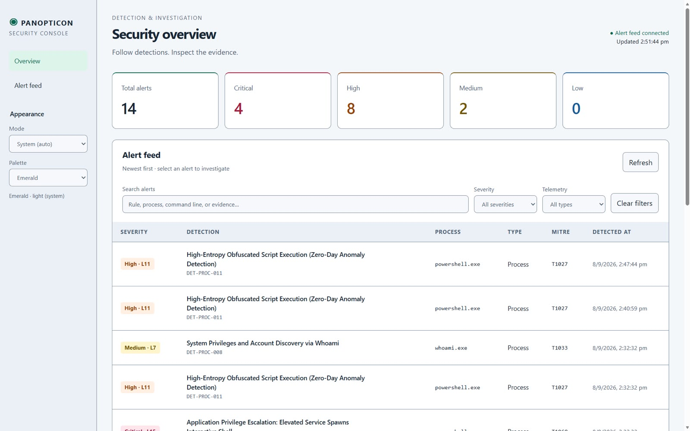

# panopticon-console

Alert, incident and response viewer for the **Panopticon&Co** EDR platform.

The console runs in one of two modes:

- **Manager mode** (`--manager-url` + `PANOPTICON_MANAGER_TOKEN`): alerts,
  incidents, pipeline status and response actions come from
  [`panopticon-manager`](https://github.com/Panopticon-Co/panopticon-manager)'s
  analyst API, proxied server-side. This is the capstone end-to-end demo path.
- **File mode** (fallback when no Manager is configured): the console reads the
  Alert NDJSON file that
  [`panopticon-detection-engine`](https://github.com/Panopticon-Co/panopticon-detection-engine)
  writes via its `--output-file` option. Only the alert feed is available.

The page header always says which source is active.

## Scope (deliberately small)

| Owns | Does **not** own |
|---|---|
| Reading the engine's alert NDJSON | Detection logic |
| Presenting alerts to a human | `Alert` creation / serialization |
| Polling for new alerts | Telemetry collection |
| Displaying Manager's incidents, pipeline status and response-action queue (optional) | Incident construction / scoring |
| Relaying analyst decisions: approve/reject a response action, set an incident's status | Remediation / response execution |

The primary integration boundary is **the alert file on disk** for
detection-engine: the console does not import it and makes no network call to
it. Optionally, this server (not the browser) can also poll `panopticon-manager`
over HTTP for a view of its response-action approval queue and analyst decisions — see
"Response actions (optional)" below. No database, no message queue, no
WebSockets, no browser-facing authentication — none of that is a V1
requirement. It is a local development / demo tool and binds `127.0.0.1` by
default.

## Requirements

Python 3.9+ standard library only. No `pip install`.

## Run

Manager mode (alerts, incidents, status, response actions):

```bash
export PANOPTICON_MANAGER_TOKEN=...   # analyst token from Manager's POST /api/v1/analysts/enroll
python app.py --manager-url http://127.0.0.1:8000
```

File mode (alert feed only):

```bash
python app.py --alerts-file /path/to/panopticon-detection-engine/alerts.ndjson
```

Then open <http://127.0.0.1:8787>. If both are given, Manager wins and the file
is ignored; if Manager is configured but unreachable, `/api/alerts` returns
`502` rather than silently falling back to a possibly stale file.

No Manager to hand? `tests/fake_manager.py` is a tiny contract-shaped stand-in
(one two-stage incident, three response actions) for demos and screenshots:

```bash
python tests/fake_manager.py --port 8799 --token demo-token &
PANOPTICON_MANAGER_TOKEN=demo-token python app.py --manager-url http://127.0.0.1:8799
```

| Flag | Default | Meaning |
|---|---|---|
| `--alerts-file` | *(none)* | Path to the engine's `--output-file`, used in file mode. May not exist yet — the console starts anyway and picks it up once it appears. Required unless Manager mode is configured. |
| `--host` | `127.0.0.1` | Bind address. Only widen deliberately. |
| `--port` | `8787` | Bind port. |
| `--manager-url` | *(none)* | `panopticon-manager` base URL. Combined with the `PANOPTICON_MANAGER_TOKEN` environment variable, switches to Manager mode. A URL without a token stays in file mode. |

### HTTP surface

| Route | Response |
|---|---|
| `GET /` | The viewer page (`static/index.html`). |
| `GET /app.js` | The client script. |
| `GET /api/alerts` | `application/json` array of alert objects. Header `X-Panopticon-Alert-Source: manager` or `file`. Manager mode: proxies `GET /api/v1/alerts` and maps each row to `row.alert` plus Manager's `detection_source`, `incident_id`, `agent_id` columns (`next_before` → `X-Panopticon-Next-Before`). File mode: file order; missing file → `[]`; malformed lines skipped. Filters `severity`, `source`, `incident_id`, `host_id`, `rule_id`, `limit` (1–1000), `before` are whitelisted and validated in both modes; anything else → `400`. |
| `GET /api/incidents` | Proxy to `GET /api/v1/incidents` (`status`, `host_id`, `limit` whitelisted). |
| `GET /api/incidents/{id}` | Proxy to `GET /api/v1/incidents/{id}`; `id` must match `[A-Za-z0-9._:-]{1,128}`. |
| `POST /api/incidents/{id}/status` | Proxy to Manager's status route. Body `{status, note?}`, `status` ∈ `open`, `investigating`, `resolved`, `false_positive`, `note` ≤ 2000 chars, no other keys, body ≤ 16 KB (`413`). |
| `GET /api/status` | Proxy to `GET /api/v1/status`. |
| `GET /api/response-actions` | Proxy to Manager's `GET /api/v1/response-actions`. |
| `POST /api/response-actions/{id}/authorize` | Same-origin analyst approval proxy. Manager remains the authority. |
| `POST /api/response-actions/{id}/reject` | Same-origin analyst rejection proxy. Requires a non-empty JSON `reason`. |

Every Manager route answers `503` when Manager isn't configured and `502` when
it can't be reached; otherwise Manager's own status and body pass through
verbatim (so a `401` from Manager shows up as `401`). The analyst token is never
in a response to the browser.

## Views

All panels poll every 3 seconds. Open dialogs are refreshed in place only when
their data changed, and polling never clears a note being typed.

- **Overview** — pipeline tiles from `/api/status`: events pending (and
  claimed), processed, failed, open incidents, pending approvals, last event
  time, agents enrolled. Shown only when Manager reports status; otherwise the
  page says status is not reported and the sidebar keeps "Collector health is
  not reported by this console." These are queue counts, not collector health.
  Below them, severity totals over all loaded alerts.
- **Alert feed** — severity, detection (title, rule, incident link), **source**
  badge (`rule` / `stateful` / `behavioral` / `correlation`, or `unknown` for
  older alert lines), process, telemetry type, MITRE technique, time. Search
  plus severity / source / telemetry filters. The alert detail shows the
  description, host, agent, **rule confidence (prior, not calibrated)**,
  matched conditions, the remaining evidence, and the `active_response`
  recommendation, labelled as a recommendation that the engine does not execute.
- **Incidents** — severity, id, score, tactics, stage count, root process,
  status, last seen. The detail shows the attack chain and summary; a stage
  timeline (time, rule, tactic/technique, process[pid], linked alert, or
  "repeat suppressed" when `stages[].alert_id` is null); process lineage as a
  tree; the causal path lines; the score breakdown with each context factor
  itemised; the `why` reasons; member alerts (each opens the alert detail);
  related response actions with command state and audit; the incident audit
  trail; and **Investigating / Resolved / False positive** buttons with an
  optional note. Incident scores are heuristic and their weights are not tuned
  yet; the page says so.
- **Response actions** — state, action and target, tier, alert, created,
  reason, **command** state, per-action **audit** trail (collapsible), and
  Approve/Reject on `PENDING` rows only.

### Wording rule

Every sentence about an outcome is derived from Manager's fields. The console
says an action took effect only when the command's state is `SUCCEEDED`, and
then says which command it was and that the *agent reported* it
("Agent reported SUCCEEDED for KILL_PROCESS (host … · pid …) · command resp-…").
Any other state is shown as-is with "no outcome reported yet". Nothing says
"neutralized" or "blocked".

### What is NOT shown

- Per-collector / per-agent health. The status tiles count the event queue.
- Raw telemetry events, and the provenance graph itself (only the incident's
  lineage and causal-path lines that the engine already rendered).
- Calibrated probabilities: `confidence` is a rule author's prior.
- Alerts beyond the newest 500 in Manager mode (`before` paging is supported by
  the API route but not yet exposed in the UI).
- Cross-host campaigns (out of scope in the engine).
- Any response execution. The console relays decisions; Manager authorizes and
  dispatches, and the agent reports results.

### File-mode behaviour

Rows whose `alert_id` was not present on the previous poll flash briefly.

### Live runs (detection-engine V2)

The detection engine's V2 `--reliable` pipeline appends each alert to its
`--output-file` the moment it is generated (`IncrementalAlertWriter`), instead
of one dump at stream end. No console change is required for this — `read_alerts`
already returns the file as it has grown so far and skips a half-written final
line, so every poll picks up new alerts while the engine is still running. Point
`--alerts-file` at the engine's `--output-file` and leave both running.

`static/app.js` de-duplicates by `alert_id` before rendering, so if the engine
ever re-appends an already-delivered alert (e.g. a restart racing its own
delivery ack) the browser shows it once. The `/api/alerts` API itself is
unchanged: it passes every line through untouched.

## Response actions (optional)

Set `--manager-url` and the `PANOPTICON_MANAGER_TOKEN` environment variable
(an analyst bearer token, see `panopticon-manager`'s
`POST /api/v1/analysts/enroll`) to show the "Response actions" panel
alongside the alert feed. Pending actions have **Approve** and **Reject**
controls. The analyst token is a **server-side** secret: this console's
Python process attaches it to outbound calls to Manager, and the browser only
ever talks to this console, same-origin. For rejection, the analyst supplies
a non-empty reason. Destructive approvals (`KILL_PROCESS` and `ISOLATE_HOST`)
require typing an exact confirmation phrase; Manager remains the authority and
the Console never executes response actions itself. The console's existing
`Content-Security-Policy` (`connect-src 'self'`) is unchanged.

## Security notes

- Alert evidence carries attacker-influenced strings (process command lines).
  The client writes every value to the DOM via `textContent` — never
  `innerHTML` string-building — and the server sends
  `Content-Security-Policy: default-src 'none'; script-src 'self'; …` plus
  `X-Content-Type-Options: nosniff` as a second layer.
- Only the routes above resolve. There is no filesystem path mapping, so
  request paths cannot be turned into arbitrary file reads. Query parameters
  and path ids are whitelisted before any request to Manager is built, and
  POST bodies are bounded at 16 KB and re-serialised from validated fields.
- Default bind is localhost. There is no browser-facing auth because there is
  nothing multi-user about a local demo; do not add one to paper over
  exposing it. The optional Manager analyst token is a server-side secret
  (an environment variable), never a browser credential.

## Test

```bash
python -m unittest discover -s tests
```

Unit tests (`tests/test_read_alerts.py`) cover NDJSON parsing: missing/empty
file, blank lines, malformed and truncated lines, non-object JSON, ordering,
and the display-field contract with the engine's `Alert.to_dict()`.
HTTP tests (`tests/test_http.py`) start a real server on an ephemeral port and
check the static routes, security headers, 404s, `HEAD`, the `/api/alerts`
payload and field set, live reflection of file updates, injection-payload
pass-through, and that two servers serve their own distinct `--alerts-file`.
`tests/test_response_actions_proxy.py` covers `/api/response-actions`: 503
when Manager isn't configured, 502 when it's unreachable, Manager's own
status/body passed through verbatim, and that the analyst token never
appears in what the browser receives.
`tests/test_manager_proxy.py` covers the Manager-mode routes: alert row
mapping, filter whitelisting and `400`s, `503`/`502`, verbatim pass-through,
the incident status body validation and `413`, file-mode filters, and an
end-to-end run against a loopback fake Manager that checks the bearer token is
attached server-side.

Node tests run the client against a minimal DOM and a mocked `fetch`
(`for t in tests/*.cjs; do node "$t"; done`): `test_dashboard.cjs`,
`test_theme.cjs`, `test_response_panel.cjs` (approve/reject only on
`PENDING`, command state, audit), `test_alert_sources.cjs` (source badges,
incident links, detail fields) and `test_incidents.cjs` (incident list and
detail, status changes, status tiles).

### Screenshots

Taken with Playwright against `tests/fake_manager.py`:
[overview](docs/screenshots/overview.png),
[alert feed](docs/screenshots/alerts.png),
[alert detail](docs/screenshots/alert-detail.png),
[incidents](docs/screenshots/incidents.png),
[incident detail](docs/screenshots/incident-detail.png),
[response actions](docs/screenshots/response-actions.png).

Taken against the **real** Manager (branch `claude/blissful-lamport-qk32ab`,
seeded with `tools/demo_seed.py`): [overview](docs/screenshots/live-overview.png),
[incidents](docs/screenshots/live-incidents.png), and
[a KILL_PROCESS the analyst approved, after the agent reported its result](docs/screenshots/live-response-succeeded.png)
(the "agent" in that run is curl).

## The full V1 demonstration

See [`docs/PANOPTICON_V1.md`](docs/PANOPTICON_V1.md) for the end-to-end
walkthrough: real Windows process creation → Officer (ETW/Sysmon) →
Schema 0.2 → detection engine → `DET-PROC-011` → `alerts.ndjson` → this console.

## Dashboard



### Appearance and theme tokens

Use Appearance in the sidebar to choose Emerald, Ocean, Violet, or Amber and
Dark, Light, or System (auto). System is the default and follows OS changes live.
Preferences persist in this browser and synchronize across tabs. If browser
storage is unavailable, changes still work for the current session.

The theme engine at the top of `static/app.js` centralizes semantic color tokens as hex values. Components
consume CSS custom properties such as `--panel`, `--text`, and `--accent`.
Add palettes to its `palettes` registry: each mode provides accent, active
background, and new-alert flash colors. Severity colors are shared per mode.
The head script applies preferences before rendering to avoid a theme flash.

The theme engine uses the existing `/app.js` route, so a browser refresh is
sufficient even when the console server is already running. Run `node tests/test_theme.cjs` for theme behavior and
text-contrast checks across all eight palette/mode combinations.

The local console includes severity totals, full-text search across alert fields,
severity and telemetry-family filters, and a newest-first feed with 25 alerts per
page. Select a detection title to open its evidence and MITRE details. Close the
panel with the Close button or Escape.

The feed refreshes every three seconds and retains the last received alerts if
connection fails. Counts cover all loaded, deduplicated alerts, independently of
filters. Feed connectivity does not indicate collector health. No additional
Python packages are needed in either mode.

After updating the static files, refresh the browser at http://127.0.0.1:8787.
There is no server restart required for these dashboard changes.

Dashboard interaction checks (optional Node.js, run from this directory):

```sh
node tests/test_dashboard.cjs
```

These checks exercise the client with a minimal DOM model, including filters,
pagination, deduplication, detail values, and connection failure/recovery. They
are not browser layout tests.

## Stack

Python 3 standard library only on the server (`app.py`, `http.server`) — no
framework, no `pip install`, no `package.json`. The client is vanilla HTML/CSS/
JavaScript (`static/index.html`, `static/app.js`) served directly, with no
build step. Node.js is used only to run the `.cjs` test scripts in `tests/`
(`node --check`, no npm dependencies) — this is **not** a Next.js/React/
TypeScript project.

## What this is not (yet)

To be explicit about scope rather than implying more than exists: there is no
browser-facing authentication, no database, and no WebSockets. The Console
relays analyst decisions to Manager but never executes remediation itself. This
is a local development/demo viewer, not a multi-user production console.

## Contributing / Security / License

- See `CONTRIBUTING.md` for development setup.
- See `SECURITY.md` for vulnerability reporting.
- See `CODE_OF_CONDUCT.md` for community standards.
- Licensed under the [MIT License](LICENSE).

## Integration with other Panopticon repos

- [`panopticon-manager`](https://github.com/Panopticon-Co/panopticon-manager) — Manager mode source for alerts, incidents, status and response actions (contract: `panopticon-detection-engine/docs/integration/CONTRACT.md` §7).
- [`panopticon-detection-engine`](https://github.com/Panopticon-Co/panopticon-detection-engine) — writes the alert NDJSON file this console reads.
- [`panopticon-agent`](https://github.com/Panopticon-Co/panopticon-agent) / [`panopticon-linux-agent`](https://github.com/Panopticon-Co/panopticon-linux-agent) — upstream telemetry producers, not integrated directly with this console.
- [`panopticon-contracts`](https://github.com/Panopticon-Co/panopticon-contracts) — canonical wire contracts used elsewhere in the pipeline.
- [Panopticon-Co](https://github.com/Panopticon-Co) — organization home.
