# Panopticon console — feature guide and demo playbook

This guide teaches every screen of the Panopticon SOC console, what each number
means and where it comes from, and gives you a rehearsed 10-minute showcase
script. Every screenshot below is a real capture of the console running
against a real Manager, seeded with the detection engine's attack corpus.

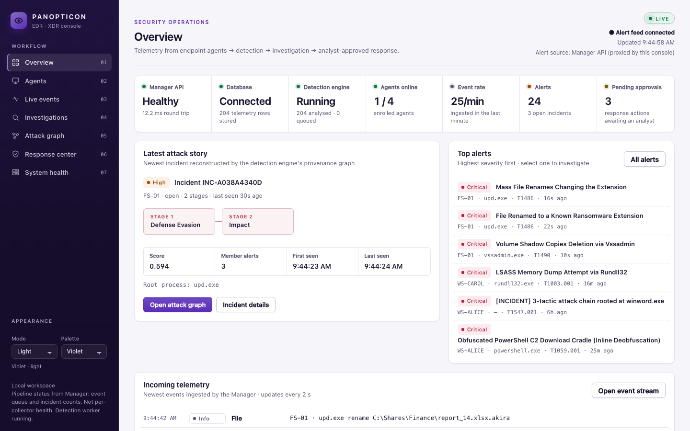

---

## 1. What you are showing

Panopticon is an EDR/XDR platform built from independent services:

```
Windows endpoint ──► officer-agent ──► Manager ingest ──► SQLite ──► detection engine
                                                                       │
          analyst ◄── console (this repo) ◄── Manager analyst API ◄────┘
             │
             └──► approve / reject ──► Response Engine ──► command queue ──► agent
```

- **Agent** collects Sysmon/ETW/PowerShell telemetry and sends it to the Manager.
- **Manager** validates and stores telemetry, runs the **detection engine**
  (rules, correlation, behavioural detections, provenance graph), stores alerts
  and incidents, and turns recommendations into commands through the
  **Response Engine**.
- **Console** is the analyst's view. It never talks to a database or the
  engine directly: it proxies the Manager's analyst API server-side, so the
  analyst token never reaches the browser.

**The one-sentence pitch:** *telemetry from endpoints becomes detections, the
detections are linked into an attack story, and an analyst approves the
response — every step is visible and audited.*

---

## 2. Launching the demo

All commands run from `panopticon-manager/`, using the workspace virtualenv.

**1 — Start a fresh Manager and console** (the old database is renamed, never deleted):

```bash
tools/demo_up.sh --fresh --python ../.venv/bin/python
```

**2 — Seed three enrolled endpoints with real attack scenarios** (Office macro →
C2 → persistence on WS-ALICE, LSASS dump on WS-CAROL, a benign workstation
WS-ERIN as background noise):

```bash
PANOPTICON_ENROLLMENT_TOKEN=$(cat demo-state/bootstrap.token) PANOPTICON_ANALYST_ENROLLMENT_TOKEN=$(cat demo-state/analyst-bootstrap.token) ../.venv/bin/python tools/demo_seed.py --url http://127.0.0.1:8000 --analyst-id seed-analyst
```

**3 — Open** <http://127.0.0.1:8787>.

**4 — During the presentation, trigger a live attack** (enrolls a new file
server FS-01 and replays a ransomware precursor — events, alerts and a new
incident appear on screen within seconds):

```bash
PANOPTICON_ENROLLMENT_TOKEN=$(cat demo-state/bootstrap.token) PANOPTICON_ANALYST_ENROLLMENT_TOKEN=$(cat demo-state/analyst-bootstrap.token) ../.venv/bin/python tools/demo_seed.py --url http://127.0.0.1:8000 --analyst-id seed-analyst --scenario ransomware_precursors_and_encryption --suffix=-live
```

Other unused scenarios for extra live moments: `fileless_powershell_lsass_dump`,
`internal_reconnaissance` (use a different `--suffix=` each time).

**Stop everything:**

```bash
tools/demo_up.sh --stop
```

### Things that will bite you

| Symptom | Cause | Fix |
|---|---|---|
| Console shows **OFFLINE**, every panel empty, `401` in System health | `demo_seed.py` was run with `--analyst-id demo-analyst` — the console's own identity — which replaces the console's credential | Always seed with `--analyst-id seed-analyst` (as above); restart with `--fresh` if it already happened |
| `demo_up: port 8000 is in use` | A previous Manager is still running | `tools/demo_up.sh --stop`, or use `--bind 127.0.0.1:8010 --console-bind 127.0.0.1:8797` (and `--url http://127.0.0.1:8010` for the seed) |
| `--suffix: expected one argument` | `-live` looks like a flag | Use the `=` form: `--suffix=-live` |
| Agents show **stale/offline** at demo time | "Online" means telemetry in the last 2 minutes | Expected after seeding; run step 4 right before you show the Agents page |
| A second seed run ingests nothing | Same scenario = same event IDs (deduplicated) | Use a different `--scenario`, or start `--fresh` |

Set the theme with **Appearance → Mode** at the bottom of the left rail. The
default is Light/Violet; Dark/Violet is tuned for dim rooms and projectors.

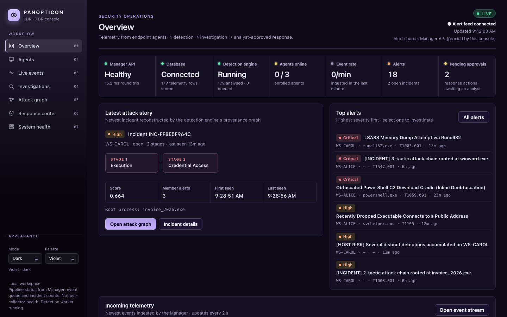

---

## 3. The screens

The left rail is the workflow, in the order an analyst works: **Overview →
Agents → Live events → Investigations → Attack graph → Response center →
System health**. The pill at the top right reads **LIVE** while the event
stream is connected and **OFFLINE** (red) if the console loses the Manager.

### 3.1 Overview — "is anything wrong, and how bad?"

The **status band** answers the at-a-glance questions; every segment is
clickable and jumps to its detail page.

| Segment | Meaning | Source |
|---|---|---|
| Manager API | Liveness + round-trip latency from the console | Manager `/healthz` |
| Database | Readiness (schema migrated) + telemetry rows stored | `/readyz`, `/api/v1/status` |
| Detection engine | Worker thread alive; events analysed vs. queued | `/api/v1/status` |
| Agents online | Enrolled agents that sent telemetry in the last 2 min | `/api/v1/agents` |
| Event rate | Events ingested in the last minute | `/api/v1/events` |
| Alerts | Alerts stored; open incidents | `/api/v1/status` |
| Pending approvals | Response actions waiting for an analyst | `/api/v1/status` |

Below it: the **latest attack story** (the newest incident, its ATT&CK stages
as a chain, score, member alerts, first/last seen) with *Open attack graph*;
**top alerts** ranked by severity (click to open the alert drawer); and the
**incoming telemetry** ticker.

Colour rules used everywhere: **violet = interactive/brand**, **red / orange /
amber = threat severity**, **green = healthy**. A red tile always means
something to look at.

### 3.2 Agents — "who is reporting?"

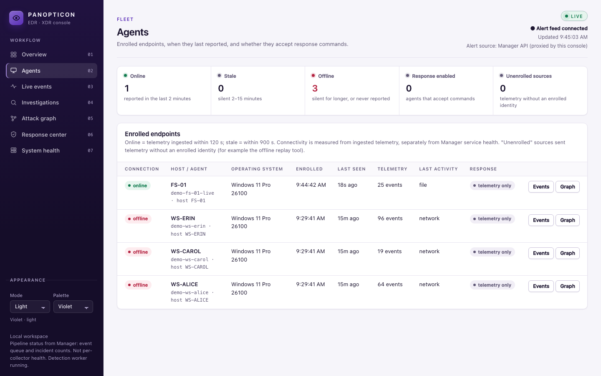

- Fleet band: online / stale / offline counts, agents that accept response
  commands, and unenrolled telemetry sources.
- Table: hostname, agent ID, OS (read from the agent's own telemetry),
  enrolment time, last seen, event counts, last activity type, and response
  capability:
  - **telemetry only** — enrolled, sending data, but not accepting commands;
  - **response enabled** — the agent opened a response channel
    (`officer-agent.exe --enable-response`), so authorized commands *will run*;
  - **replay / unauthenticated** — telemetry that arrived without an enrolled
    identity (e.g. the offline replay tool). Shown, but labelled.
- *Events* filters the event stream to that host; *Graph* opens its process tree.

Connectivity here is measured from telemetry and is deliberately separate
from service health (System health page).

### 3.3 Live events — "what is happening right now?"

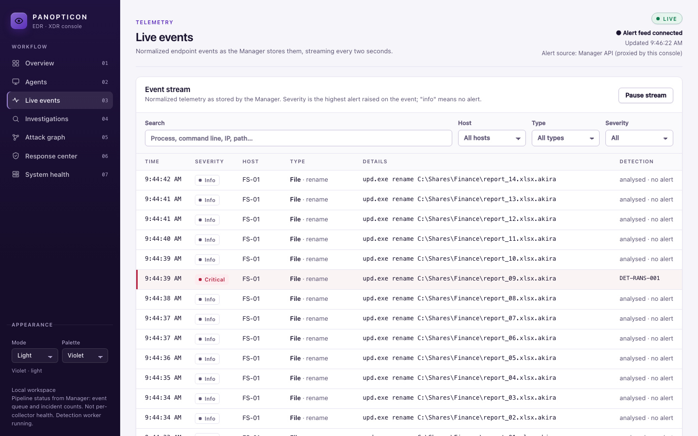

New events stream in every 2 seconds without reloading (new rows flash).
Search across the whole raw event, filter by host, type and severity, pause
the stream to read, and click any row to see the full normalized JSON.
**Severity** is the highest alert raised on that event; *info* means it was
analysed and nothing fired. Rows with high/critical alerts carry a coloured
edge and show the rule that fired.

### 3.4 Investigations — "what did detection find?"

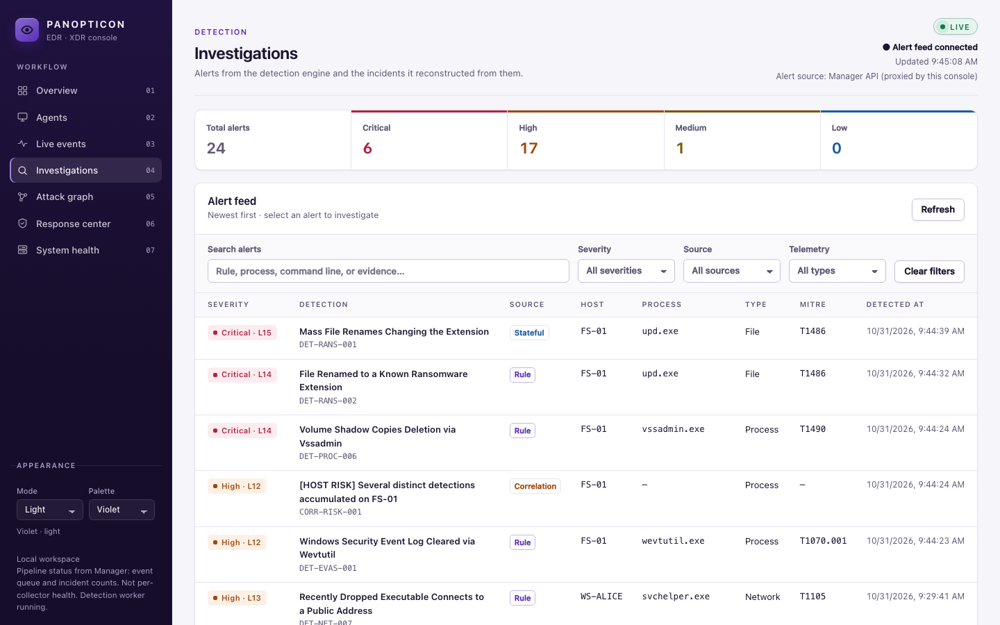

- Severity totals, then the **alert feed**: severity + level, detection title
  and rule ID, detection source (*rule*, *stateful*, *behavioural*,
  *correlation*, *ML*), host, process, telemetry type, MITRE technique, time.
  Search and filter; click a title to open the **alert drawer**.
- **Incidents**: alerts the engine causally linked into one attack — score,
  tactics, number of stages, root process, analyst status.

**Alert drawer** — rule, MITRE mapping, host, agent, matched conditions (why it
fired), raw evidence, and the recommended response. *Open attack graph* jumps
to the process tree with this alert's process highlighted; *Respond to this
alert* pre-fills a response request.

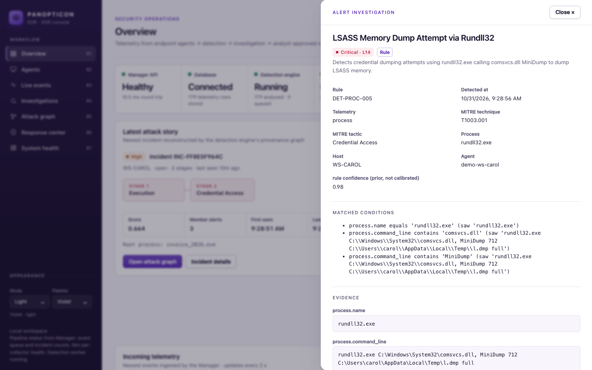

**Incident drawer** — attack chain, score breakdown, root cause process,
stage timeline, process lineage, causal path, member alerts, related response
actions, audit trail, and the analyst status controls (*Investigating*,
*Resolved*, *False positive*, with a note — persisted in the Manager).

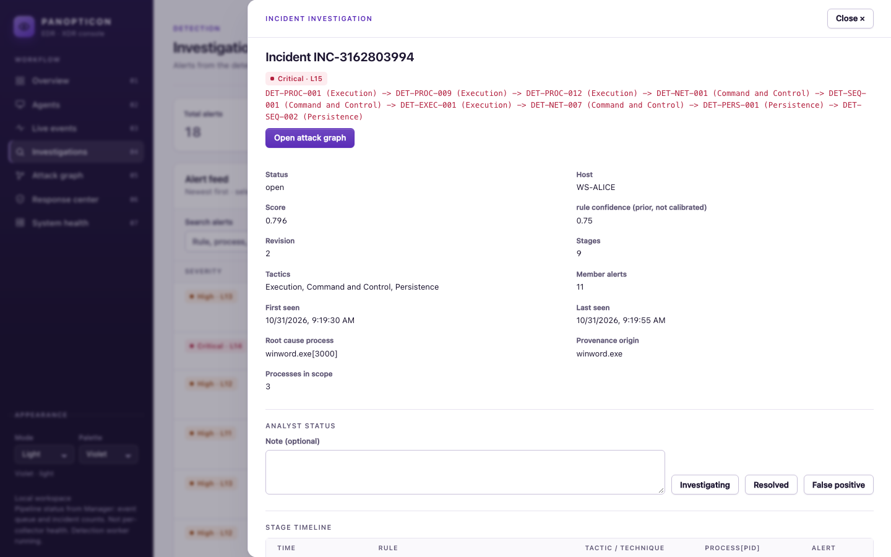

### 3.5 Attack graph — the centrepiece

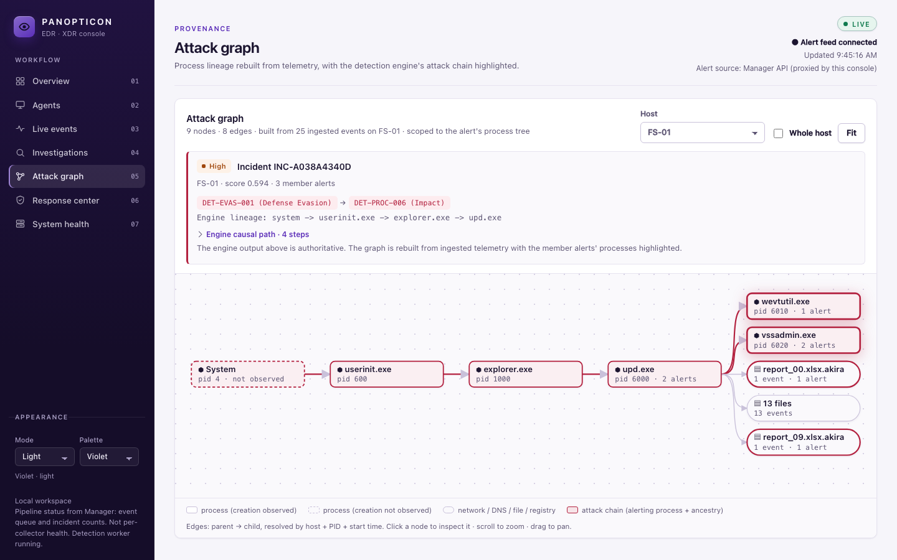

What it is: the process tree of the host, rebuilt from the telemetry the
Manager stored, with the detection engine's verdict overlaid.

- **Nodes** are processes (rectangles) and their activity — network
  destinations, DNS lookups, files, registry keys (rounded).
- **Edges** go parent → child. A child's parent is resolved the same way the
  engine does it: host + PID + start time (PIDs are reused, so the PID alone
  is not enough).
- **Red outline + red edges** = the attack chain: every process an alert fired
  on, plus its ancestry back to the root.
- **Dashed node** = a process whose start was never observed (known only from a
  child's parent fields). It is shown, not invented.
- **Grouped node** ("13 files", "30 destinations") = routine activity of one
  kind folded together so the tree stays readable. Anything that raised an
  alert is never grouped — in the ransomware example the two `.akira` renames
  stay individually highlighted.
- The **context card** above the graph shows the engine's own output — the
  rule chain, its lineage and the causal path — which is the authoritative
  record. The graph is the visual reconstruction.
- **Click a node** for its inspector (command line, PID, parent, user, times,
  alerts on it, recent events). Scroll to zoom, drag to pan, *Fit* to reset,
  *Whole host* to see everything on the machine. The graph updates live as
  new events arrive.

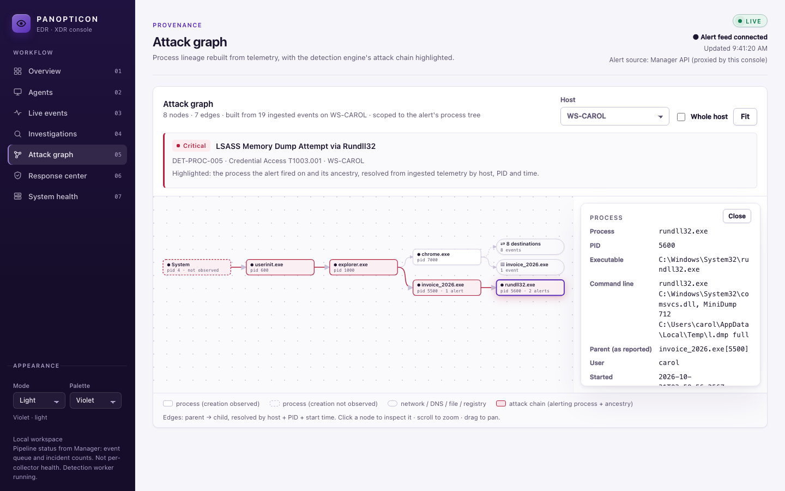

### 3.6 Response center — "contain it, safely"

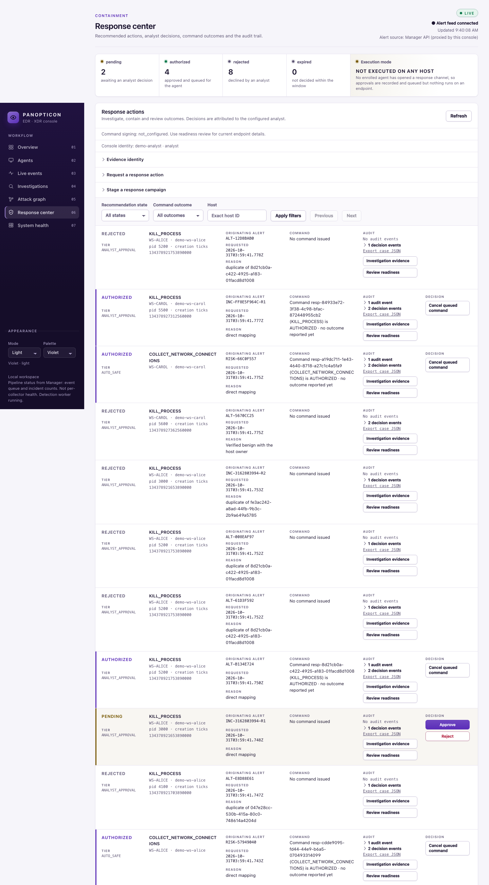

- Band: pending / authorized / rejected / expired, and the **execution mode**
  banner. It says **NOT EXECUTED ON ANY HOST** unless an enrolled agent has
  opened a response channel, and **REAL ENDPOINT ACTIONS** (naming the hosts)
  when one has. This is how you prove nothing is faked.
- Each response action is a row: state and approval tier, the action and its
  exact target (host, PID and process creation time — a guard against killing
  a recycled PID), the originating alert, the reason, the command state, the
  audit trail, and the decision buttons.
- **Approval policy (Response Engine):** read-only collection
  (`COLLECT_PROCESS_INFO`, `COLLECT_NETWORK_CONNECTIONS`) is auto-authorized
  (`AUTO_SAFE`); disruptive actions (`KILL_PROCESS`, `ISOLATE_HOST`,
  `QUARANTINE_FILE`, …) need an analyst (`ANALYST_APPROVAL`). Duplicate
  recommendations are rejected automatically.
- **Approve** asks you to type a confirmation phrase
  (e.g. `APPROVE KILL_PROCESS ALT-…`) before anything is sent. **Reject**
  asks for a reason. Both are persisted and appear in the audit history.
- *Request a response action* and *Stage a response campaign* create manual
  requests (they also wait for approval). *Investigation evidence* and
  *Review readiness* show signed evidence and whether the target agent can
  actually execute.
- **Response audit history** at the bottom is the Manager's hash-chained
  ledger, newest first.

### 3.7 System health — "is the platform itself OK?"

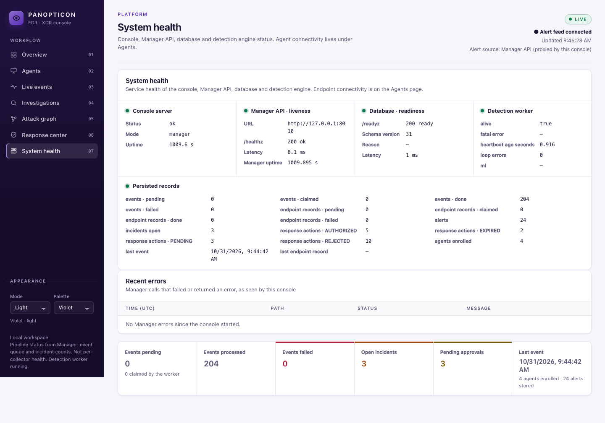

Console server, Manager liveness and latency, database readiness and schema
version, detection worker (alive, heartbeat, loop errors, ML stage), every
persisted record count, and recent errors the console saw talking to the
Manager. Agent connectivity is intentionally not here — a healthy platform
with silent agents is a different problem from a broken platform.

---

## 4. The 10-minute showcase script

Before you start: steps 1–2 of §2 done, console open on **Overview**, the
step-4 command ready in a terminal.

| Time | Screen | Do | Say |
|---|---|---|---|
| 0:00 | Overview | Point at the status band left to right | "Platform healthy, database connected, detection running, three endpoints enrolled, alerts raised, approvals waiting. You can read this row without me." |
| 0:45 | Overview | Point at the attack story | "The engine didn't just raise alerts — it linked them into one attack: Execution, then Credential Access, rooted at `invoice_2026.exe`." |
| 1:15 | Agents | Show the table | "Each endpoint enrolled with its own key pair. OS and hostname come from the agent's telemetry. 'Telemetry only' means it reports but won't accept commands." |
| 2:00 | *(terminal)* | Run the step-4 live command | "Now a file server gets hit by ransomware, live." |
| 2:15 | Live events | Watch rows stream in; filter Severity → *Alerted only* | "No refresh — the console tails the Manager. Every event is analysed; these rows triggered detections." |
| 3:15 | Overview | New critical alerts on FS-01, new attack story | "Defense Evasion then Impact — shadow copies deleted, files renamed to `.akira`." |
| 3:45 | Attack graph | *Open attack graph* on the story | "System → userinit → explorer → `upd.exe`. It spawned `vssadmin` and `wevtutil` and renamed files. The 13 routine writes are grouped; the two ransomware renames are highlighted because they alerted." |
| 5:00 | Attack graph | Click `vssadmin.exe` | "Full command line, parent, user, timestamps, the alerts on this exact process." |
| 5:45 | Investigations | Open the WS-ALICE critical incident drawer | "A longer chain: Word macro → PowerShell → dropped `svchelper.exe` → C2 beacon → registry persistence. Nine stages, eleven alerts, one incident." |
| 6:45 | Attack graph | *Open attack graph* in that drawer | "Thirty outbound connections from Chrome are folded away; the malicious path is the red one." |
| 7:30 | Response center | Point at the execution-mode banner | "Honesty first: no agent here has response enabled, so the banner says nothing will execute. Collection was auto-approved; killing processes needs me." |
| 8:15 | Response center | Approve a pending `KILL_PROCESS` (type the phrase) | "Two-step confirmation, then it's authorized and queued for the agent — with the PID *and* the process creation time, so we can't kill a recycled PID." |
| 9:00 | Response center | Reject another with a reason; scroll to audit | "Every decision lands in a hash-chained audit ledger." |
| 9:30 | System health | Show the cards | "And the platform reports on itself separately from the endpoints." |

If you have a Windows VM with `officer-agent.exe --enable-response`, start it
before 7:30: the banner flips to **REAL ENDPOINT ACTIONS** and an approved kill
actually terminates the process — say so explicitly when it happens.

---

## 5. Real vs. replayed — what to say if asked

- **Real:** the Manager, database, detection engine, enrolment (ECDSA key pairs),
  response approval policy, command queue and audit ledger are the production
  code paths. Approving in the console really authorizes a command in the
  Manager and persists it.
- **Replayed:** the seed scripts replay the detection engine's attack corpus
  through the Manager's real ingest API, with timestamps moved to "now". It is
  hand-built telemetry that mirrors what the Windows agent sends, not traffic
  captured from a live compromise.
- **Not executed in this demo:** no endpoint runs the approved command unless
  an agent started with `--enable-response` is connected; the console says so
  on the Response center banner and on the Agents page.

---

## 6. Likely questions

**How does the graph know parent/child relationships?** From process-creation
telemetry (Sysmon EID 1 and ETW Kernel-Process): each child reports its
parent PID. Because PIDs are reused, the parent is the newest process with that
PID that started before the child — the same rule the engine's provenance
registry uses.

**Is the attack chain the console's guess?** No. Which processes are on the
chain comes from the alerts the engine raised; the rule chain and causal path in
the context card are the engine's own incident evidence. The console only draws it.

**Why can't detection kill a process automatically?** Policy: only read-only
collection is auto-approved. Disruptive actions need an analyst, and the target
includes the process creation time so a stale recommendation cannot hit a new
process that reused the PID.

**What happens if the Manager goes down?** The LIVE pill turns red, panels show
"not available" with the reason, and System health lists the failing calls. The
console never falls back to stale data silently.

**Where does the data live?** One SQLite database owned by the Manager. The
console is stateless and binds to `127.0.0.1` by default.

---

## 7. Design notes (if the panel asks about the UI)

- Light-first violet-and-white identity; a deep-violet navigation rail anchors
  the brand, content sits on white surfaces with hairline borders and soft
  shadows.
- Status is a single segmented band, not a grid of cards: one surface, one
  scan line.
- Severity colours are reserved for threats and never used decoratively;
  interaction is always violet; health is always green.
- Tabular numerals, an 11/12.5/13/15/22/24 px type scale, two weights for
  most text.
- Motion only where it carries information: the live pulse, new-row flash,
  graph nodes fading in, drawers sliding in. All of it is disabled when the
  OS asks for reduced motion.
