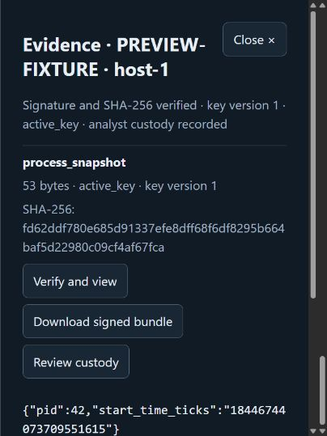

# Signed investigation evidence

In Response actions, expand **Evidence identity** and sign in with your individual
analyst credential. An evidence administrator must already have granted that
credential access to the exact originating case and endpoint. Existing shared
Console response credentials never act as an evidence-access fallback.
Shared queue and case-export routes redact artifact metadata/custody even when
their configured credential has an explicit grant.

Select **Investigation evidence** on a response record. Each artifact shows its
kind, size, SHA-256, signing-key version and current trust state. **Verify and view**
retrieves bounded frames, verifies ES256 and exact content hash, records the
authenticated analyst acknowledgement on Manager, then displays JSON as literal
text. **Download signed bundle** performs the same checks before exporting the
original signed manifest and base64 content, with the separately authenticated
key/case context. It never exports a plain original endpoint file.

**Pause transfer** preserves verified partial frames only in bounded session
memory; retry resumes from the next frame after fetching fresh scope/key context.
At most four artifacts of at most 1 MiB each may be cached. Closing the dialog,
signing out or changing identity clears partials and visible content. An opaque
public session version accompanies each evidence request so a stale tab cannot
silently use another browser identity after a cookie changes. The credential
itself remains HttpOnly/server-side and never enters local storage.

Compromised-key evidence remains listed with its reason, but content controls are
disabled. Backend enforcement independently blocks retrieval. Unsigned historical
evidence is retained and labelled, with content download blocked. Custody remains
available to scoped readers through **Review custody**, with bounded pagination.
History includes endpoint production, transfer, signature/hash verification,
download frames and attributed view acknowledgement. A browser acknowledgement
is not cryptographic proof that someone read the screen.

The browser does not release content if signature/hash validation, case binding,
current scope or mandatory custody recording fails. A signed bundle can be checked
offline against an independently trusted key, but current compromise/revocation
status requires a fresh Manager lookup.

Validation combines real WebCrypto signatures, interrupted transfers and lost
receipt tests, access-revocation regressions, UI literal-rendering/audit-failure
tests and a browser fixture preview. The screenshot below uses synthetic central
contract fixture data; it is not a native endpoint E2E result.

